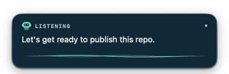
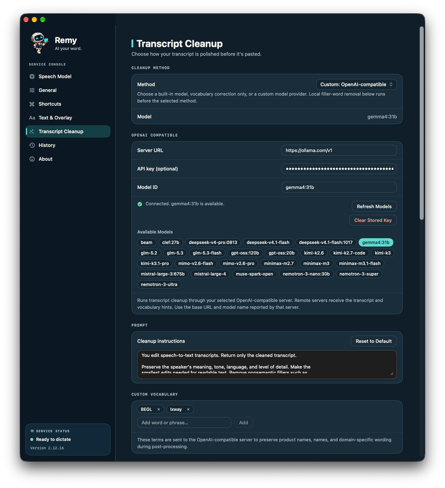
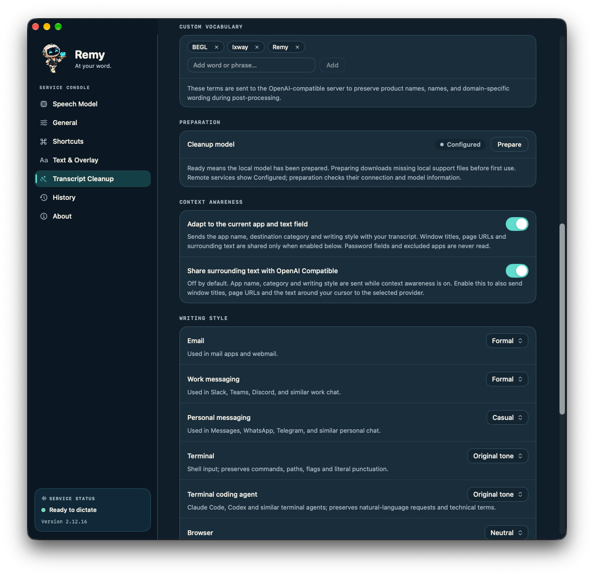
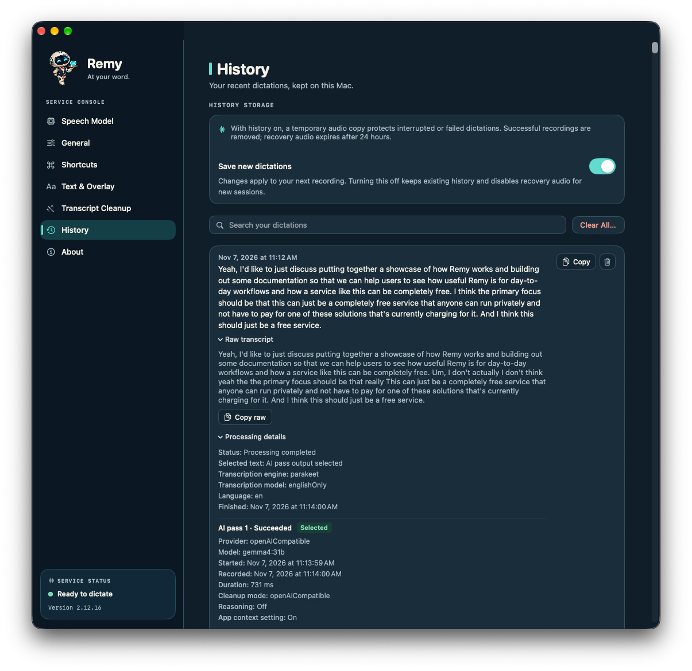

<p align="center">
  
</p>

<h1 align="center">Remy</h1>

<p align="center">
  <strong>Talk instead of type. Remy serves clean, ready-to-send text wherever your cursor is.</strong><br>
  Free, open-source dictation for the Mac. Your voice never leaves your computer.
</p>

<p align="center">
  <a href="https://github.com/brysonjl/remy/releases/latest"><strong>Download for Mac</strong></a> ·
  <a href="#quick-start">Quick start</a> ·
  <a href="#under-the-hood">Under the hood</a> ·
  <a href="#build-from-source">Build from source</a>
</p>

<p align="center">
  
</p>

Remy is a free alternative to subscription dictation apps like Wispr Flow. Hold a
shortcut, say what you mean, let go. Remy transcribes on your Mac, tidies the
transcript, matches the tone of the app you're in, and puts the text in the field
you were typing in. No account, no subscription, no audio in the cloud.

> **Early beta.** Remy is new and runs on Apple silicon Macs. Expect rough edges,
> and please [report what you find](https://github.com/brysonjl/remy/issues).

## Why Remy

### 🔒 Private by default

Speech recognition runs entirely on your Mac with NVIDIA's Parakeet v2 model, or
Apple's on-device speech recognition. It works offline, and your recordings are
never uploaded anywhere. Transcript cleanup can stay local too: use the built-in
S1-mini model, Apple Intelligence or your own Ollama models. If you prefer a cloud
model, bring your own OpenRouter or OpenAI-compatible provider. Only text is sent,
and only when you set it up.

### ✨ Clean text, not raw transcripts

Spoken language is messy. Remy's cleanup removes "um"s and "uh"s, drops false
starts and accidental repeats, keeps the version you meant when you correct
yourself mid-sentence, and adds punctuation and capitalization. It edits, it
doesn't rewrite: names, numbers, code and your meaning are preserved, and if
cleanup ever fails you still get your original words.

<p align="center">
  
</p>

### 🎯 Knows where you're typing

With Context Awareness on, Remy notices what kind of app you're dictating into and
adjusts. Polished sentences for email, relaxed and period-free for a quick chat
message, precise and literal for a terminal or coding agent. Pick a style for each
kind of app: Formal, Neutral, Casual, Very Casual, Excited or your original tone.

Remy recognizes email, work and personal messaging, browsers, terminals, coding
agents and AI chat apps. Sharing nearby text with a cloud provider is a separate
opt-in that's off by default.

<p align="center">
  
</p>

### 📚 Learns your words

Add names, product terms and jargon to your custom vocabulary so they come out
right the first time, or add one on the fly from the quick vocabulary panel. Save
cleanup setups as named profiles and switch between them.

### 📍 Lands in the right place

By default, text goes back to the field where you started talking, even if you
clicked somewhere else while Remy worked. Prefer it to follow you? Switch to
"Where I'm focused when it finishes." Remy checks the destination and your
clipboard before pasting. If it can't deliver safely, it holds the text so you can
paste it yourself.

### 🗂️ Never lose a thought

Every dictation is saved in a searchable local history (or turn history off),
with the raw transcript kept next to the cleaned text so you can see exactly what
changed and copy either one.
If a session is cancelled or interrupted, Remy keeps a recovery copy so you can
pick it up again. Long dictations are supported.

<p align="center">
  
</p>

### 🎛️ Feels good to use

- **Hold to record** or **tap to toggle**, on any shortcut you like.
- A floating recorder with a live waveform and transcript preview.
- Start and finish sounds, including your own custom sounds.
- Lives in your menu bar, with or without a Dock icon.

## Quick start

1. **Download** the latest `Remy-<version>-arm64.dmg` from
   [Releases](https://github.com/brysonjl/remy/releases/latest), open it and drag
   **Remy** to **Applications**.
2. **Open Remy** and allow **Microphone** and **Accessibility** access when asked.
   Accessibility is what lets Remy type into other apps.
3. **Get the speech model.** In **Speech Model**, choose **FluidAudio** with
   **Parakeet v2** and click **Download Model**, then **Prepare Model** if offered.
   It's a one-time download of about 465 MB.
4. **Pick a shortcut** in **Shortcuts**, and choose **Hold to Record** or
   **Tap to Toggle**.
5. **Try it.** Click into any text field, hold your shortcut, say a sentence and
   let go.

Then explore **Transcript Cleanup** to choose a cleanup model, and
**Context Awareness** to set a style for each kind of app. Cloud providers ask for
your own API key, which is stored in your macOS Keychain.

**Requirements:** an Apple silicon Mac (M1 or later). The app targets macOS 14 and
later; testing so far has been on recent macOS releases. Updates are manual for
now: download the new DMG and replace the app.

## Privacy

- **Audio stays on your Mac.** Speech recognition is local, and cloud speech
  recognition is turned off.
- **Cloud cleanup is opt-in.** If you configure a remote provider, it receives the
  transcript text and your vocabulary. With Context Awareness on, it also gets the
  app type and writing style. Nearby text needs a separate opt-in.
- **Your data is local.** History and recovery audio live on your Mac, with
  retention and deletion controls in the app.

Details: [privacy and data lifecycle](docs/privacy.md).

## Under the hood

| | |
| --- | --- |
| **App** | Native Swift/SwiftUI macOS app, Apple silicon |
| **Speech recognition** | [Parakeet TDT 0.6B v2](https://huggingface.co/nvidia/parakeet-tdt-0.6b-v2) (English) via [FluidAudio](https://github.com/FluidInference/FluidAudio); Apple's on-device speech recognition as an alternative on macOS 26 and later. Model downloads are pinned to an exact revision and hash-verified |
| **Cleanup, local** | S1-mini (in-app download, English), Apple Intelligence, Ollama |
| **Cleanup, bring your own** | OpenRouter and any OpenAI-compatible endpoint, with named profiles; keys in the Keychain |
| **Delivery** | Accessibility-based insertion with destination and clipboard checks, and manual paste as a fallback |
| **Storage** | Local history, recovery and settings in `~/Library/Application Support/io.github.brysonjl.remy` |
| **Updates** | Manual, from notarized DMGs on GitHub Releases |

More detail: [architecture and session contracts](docs/architecture.md),
[cleanup policy](docs/cleanup-policy.md) and
[third-party notices](THIRD_PARTY_NOTICES.md).

## Build from source

You need an Apple silicon Mac and full Xcode. The build is verified with
**Xcode 27.1 (27A9275), Swift 6.4, macOS 27.0 SDK** and **Xcode 27.2 (27B52),
Swift 6.4.2, macOS 27.2 SDK**. The first build needs internet access to fetch
dependencies.

To compile and run the tests without a signing certificate:

```sh
git clone https://github.com/brysonjl/remy.git
cd remy
app/scripts/remy-build.sh resolve
app/scripts/remy-build.sh build
app/scripts/remy-build.sh test -parallel-testing-enabled NO
```

<details>
<summary><strong>Build and install your own signed copy</strong></summary>

You need an **Apple Development** signing certificate and its team configured in
Xcode. Create `app/Config/Signing.local.xcconfig` (ignored by Git) with your
ten-character team ID:

```xcconfig
DEVELOPMENT_TEAM = YOURTEAMID
```

Quit **Remy** and **Remy Dev**, then from the repository root:

```sh
app/scripts/remy-local.sh prepare
app/scripts/remy-local.sh install
open "$HOME/Applications/Remy.app"
```

`prepare` builds and verifies a signed Release app. `install` places it in
`~/Applications/Remy.app` and keeps the previous copy for rollback. A self-built
copy and the downloaded app share data but have separate macOS permissions. See
[local installation, migration and rollback](docs/engineering/local-installation.md).

</details>

<details>
<summary><strong>Development commands</strong></summary>

```sh
# Compile without signing or installing.
app/scripts/remy-build.sh build
app/scripts/remy-build.sh build Release

# Run isolated app tests, or the dependency-free utility subset.
app/scripts/remy-build.sh test -parallel-testing-enabled NO
validation/run-tests.sh

# Signed interactive Debug app ("Remy Dev"), staged at .local/run/Remy Dev.app.
app/scripts/remy-dev.sh prepare
app/scripts/remy-dev.sh launch
```

Remy Dev keeps its own data and permissions, separate from Remy. See the
[source guide](app/README.md) and
[local development guide](app/docs/engineering/local-development.md).

</details>

## Contributing

Bug reports, ideas and pull requests are welcome. Start with
[contributing](CONTRIBUTING.md); report security issues privately as described in
[security](SECURITY.md).

<details>
<summary><strong>Project documentation</strong></summary>

- [Release readiness and supported scope](docs/release-readiness.md) and [release process](app/RELEASE.md)
- [Changelog](CHANGELOG.md)
- [Privacy and data lifecycle](docs/privacy.md)
- [Architecture and session contracts](docs/architecture.md)
- [Cleanup policy](docs/cleanup-policy.md)
- [Local installation, migration and rollback](docs/engineering/local-installation.md)
- [Engineering baseline and validation evidence](app/docs/engineering/baseline.md)
- [Source release verification](validation/results/2026-11-05-source-release/README.md)
- [Context-aware cleanup verification](validation/results/2026-10-20-context-awareness/README.md)
- [Arc paste-guard repair and live confirmation](validation/results/2026-10-20-arc-paste-guard/README.md)
- [Implementation plan](docs/implementation-plan.md) and [acceptance criteria](docs/evaluation/acceptance.md)
- [How this repository was published](docs/engineering/publication.md)
- [Asset provenance](docs/engineering/asset-provenance.md)

The application source lives in `app/`. Files under `research/upstream/` are
reference snapshots with their own notices, not build dependencies.

</details>

## Credits and license

Remy is an independent adaptation of
[Dictate Anywhere](https://github.com/hoomanaskari/mac-dictate-anywhere) by
Hooman Askari. See [attribution](ATTRIBUTION.md). Remy is released under the
[MIT license](LICENSE); dependencies and models keep their own licenses, listed in
[third-party notices](THIRD_PARTY_NOTICES.md).
