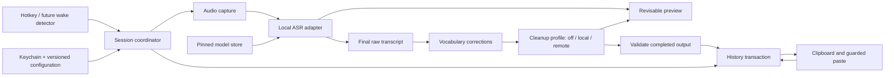
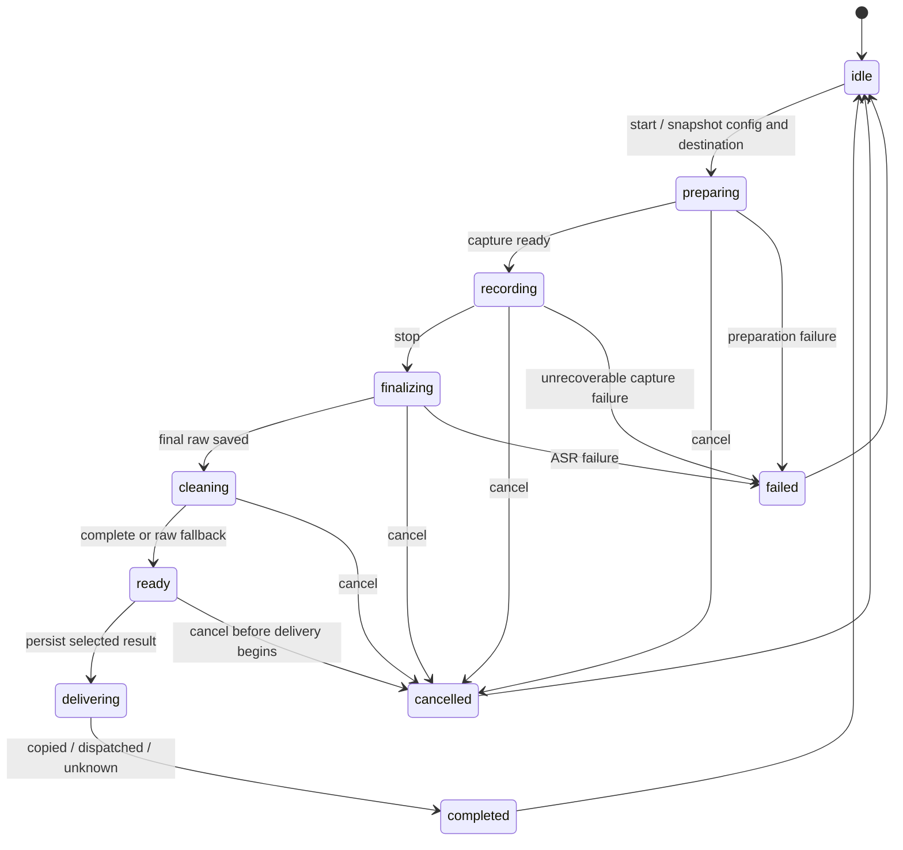

# Architecture and implementation contracts

Status: proposed Remy boundaries. These names are design contracts, not claims that these modules already exist. Implement adapters around the fork's existing `TranscriptionEngine`, `HotkeyService`, `TextInserter`, provider services and history UI. Incrementally move coordination out of `AppState`; do not begin with a wholesale rewrite.

## Component map

The menu bar app owns UI, permissions, capture, target identity, and the session coordinator. Inference executes away from the main actor and realtime audio callback. Initially retain the existing inference process topology to establish parity. A separately signed XPC speech worker is the preferred crash-containment evolution, subject to a measured IPC/Core ML/signing spike; do not claim helper isolation while using an in-process engine. Keep the same recognizer protocol in either topology. Ollama already runs outside the app. HTTP cleanup does not need another process.

Use Swift structured concurrency for work ownership, an actor/serialized coordinator for transitions, `@MainActor` only for UI/AppKit interactions, and one history writer. Cancellation alone is insufficient: late completions must also pass session/generation checks.

## Session state and invariants

- At most one foreground dictation session. Start while finalizing/cleaning reports busy; it does not create hidden parallel capture. Reprocessing History can queue at lower priority and never owns automatic paste.
- A session has UUID, generation, configuration snapshot, monotonic audio offsets, and monotonic event sequence. Every ASR/provider/UI callback carries the session/generation. Drop stale callbacks after cancellation, timeout, model switch or replacement.
- Settings changed during a recording apply to the next session. Model installation/switching occurs while idle. Snapshots contain credential references, never key values.
- Stop ends capture immediately, drains already captured PCM, and flushes the final decoder tail exactly once. Duplicate key-up/stop events are idempotent. VAD cannot silently end a toggle session unless that option is explicitly selected.
- Preview is disposable and revisable. Final raw text is immutable. Cleanup failure cannot destroy raw text. Empty/silent input does not invoke cleanup or overwrite clipboard.
- Cancel prevents any new delivery. If a paste was already dispatched, cancellation cannot retract it; show the truthful delivery state. A second Stop during cleanup may offer “Use raw now” through a distinct explicit action, never a second finalization.
- Serialize cancellation and delivery authorization through the coordinator, with a final eligibility-token check immediately before each clipboard or paste side effect. Focus validation remains best effort across the external OS boundary; no lock in Remy can freeze another application's focus.
- Persist a delivery intent before OS interaction. Crash recovery never automatically repeats a paste. Exactly-once insertion cannot be guaranteed across an OS event/process crash boundary.

## Domain interfaces

The following is interface notation, not a compilable Swift API commitment. A00/A02 adapt it to existing types and lock a shared contract before parallel changes.

| Interface | Requests | Events/results | Invariant |
| --- | --- | --- | --- |
| ActivationSource | enable/disable, bind | start, stop, cancel with gesture ID | No inference/UI work inside key tap |
| AudioCapture | start(session, device), stop, cancel | PCM batches, route change, failure | Monotonic sample offsets; bounded queue; no silent dropping |
| Recognizer | prepare(model), begin(session), append(PCM), finish, cancel, unload | partial(revision/range), final, failure | One terminal event; explicit batch/native-streaming capability |
| CleanupProvider | discover, validateProfile, transform(request), cancel | answer delta, completed, failure | Completion required; reasoning/tool deltas never become output |
| HistoryRepository | begin, saveRaw, appendAttempt, selectOutput, recordDelivery, query, delete | transaction result / typed failure | No overwrite of raw or previous attempts |
| OutputDispatcher | captureDestination, copy, validateAndPaste | copied, dispatched, verified, uncertain, blocked | No automatic retry after dispatch |
| ModelStore | inspect, install, verify, activate, rollback, remove | progress, installed revision, failure | Staged download; explicit activation; known revision/checksums |

`TranscriptEvent` includes schemaVersion, sessionID, sequence, kind, text, sampleRange if available, isFinal, engine/model revision and timestamp. Only `isFinal=true` is accepted by cleanup and ordinary output. Future consumers cannot reinterpret a partial as a command authorization.

`CleanupRequest` includes sessionID/attemptID, immutable input, instruction version/text, vocabulary version, profile ID/snapshot, locale and deadline. Capabilities cover transport (`SSE`, `NDJSON`, complete JSON), discovery, cancellation, thinking controls, context/output budgets, and structured output. Do not infer these from a provider's marketing name.

## Capture, model installation and latency

Capture once; convert to the recognizer's 16 kHz mono float format off the audio callback. Bounded PCM queues have explicit backpressure/overflow behavior. Reduce/skips preview work before sacrificing captured audio; if no storage capacity remains, stop with a recoverable failure rather than silently losing samples. Limit individual sessions initially to 15 minutes with a visible warning/stop; this is configurable after long-session tests.

Keep the selected ASR model warm according to a user setting; record cold compilation/load separately. Schedule final decode ahead of preview. Avoid running full-utterance batch preview on every buffer; use bounded windows and preserve the authoritative final pass. Do not load two heavyweight engines by default merely to obtain preview and final output.

Model manifest: model family, exact model revision, upstream/conversion URLs, license, artifact filenames/sizes/SHA256, runtime compatibility, language support, installed path and validation status. Download to staging; verify all assets; atomically activate a complete bundle. Startup and ordinary dictation must not implicitly fetch newer assets. Cancellation removes partial installations safely. Model removal must reject an active in-use bundle. Inject a Remy-owned cache root: upstream uses `~/Library/Application Support/FluidAudio/Models` independently of its bundle ID. If existing assets are reused from a shared cache during the baseline, treat them as read-only; Remy must never remove or repair another app's models.

Build baseline against the fork's FluidAudio 0.17.5 lock; the reviewed 0.17.7 and Nemotron tiers are a separate upgrade candidate. Pin model assets as well as package source; dependency pinning alone cannot prevent a loader from fetching mutable weights. [Verified runtime caveats](research/speech-runtime.md).

## Persistent data

Use SQLite behind a repository interface, with GRDB as the preferred Swift adapter if the build spike validates it. Start with a single writer/queue and choose journal mode deliberately; pin/audit the actual SQLite runtime, including the WAL caveat in [platform research](research/platform-and-providers.md). Never assume the OS's SQLite matches the development CLI.

| Table | Minimum fields |
| --- | --- |
| `sessions` | id, created/finished times, status, language, duration, raw_text nullable, corrected_text nullable, selected_attempt_id nullable, selected_output nullable, ASR model/revision, settings snapshot/version, destination bundle ID, error category, interrupted flag |
| `cleanup_attempts` | id, session_id FK, attempt index, profile snapshot without credentials, provider/model/revision if available, prompt snapshot/version, vocabulary version, input_text, output_text nullable, status, error category, first-token/total timing, created_at |
| `deliveries` | id, session_id FK, selected attempt nullable, exact clipboard/delivery text, destination identity summary, outcome, reason, intent/dispatched/verified times, verification method nullable |
| `vocabulary_rules` | id, source, replacement, match/case mode, language/app scope, enabled, version |
| `correction_runs` | id, session_id FK, immutable rule snapshot/version, matched source ranges/rule IDs, corrected_text |
| `schema_migrations` | migration ID, applied timestamp |

Index session time/status; use FTS5 for raw/final text search if available in the validated runtime. Treat the FTS index as derivative, with rebuild and deletion paths. Preserve prompt/profile snapshots for reproducibility; do not store authorization headers, access tokens, full app-window contents, or provider response bodies by default. Diagnostics are timing/counters/error categories without transcript text.

Migration from upstream preferences is transactional and repeatable: back up/export legacy JSON, import original IDs/timestamps and whatever raw/cleaned fields exist, mark absent provenance as unknown, verify count/content, then mark migration complete. Do not delete source until verification succeeds. Because Remy uses an independent bundle identity, importing another app's history is an explicit user-selected import, not automatic reading of Spokenly or Dictate Anywhere preferences. Migration within a Remy pre-SQLite development build may use its own domain automatically.

Default text history persists until deleted; offer retention age/size and a history-off mode. Intentional history-off uses an ephemeral repository that acknowledges in-memory operations and permits delivery, clearly labeled “History off”; this is not a disk-write failure. It writes no transcript/prompt/attempt/audio records to disk and offers no restart recovery. Changing the setting applies to new sessions and does not silently delete earlier history. When history is enabled, each capture now uses a temporary local recovery audio file with restricted permissions and exclusion from backups. Successful processing removes it; recognition or persistence failure retains it for explicit recovery for up to 24 hours. Intentional cancellation retains audio only when its separate preference is enabled. The writer queue is bounded; overload or write failure stops capture with an incomplete-audio warning. Valid orphan recordings are discovered on restart, but abrupt process death can still lose unflushed samples or leave an unreadable file. The planned session duration/disk quota and crash fault gate remain open.

Deletion, clear-all and retention invalidate pending reprocessing jobs before removing data. Use a session deletion generation/tombstone or repository-level existence precondition so a late provider callback cannot recreate sessions, attempts, audio or FTS rows. Deleting an active session revokes its delivery eligibility and cancels pending work. Do not retain deleted transcript content in tombstones.

At rest, the default database relies on OS account/file permissions and disk encryption; do not market application-level encryption. Deletion removes rows/FTS/audio and schedules appropriate database maintenance, but cannot promise erasure from filesystem snapshots or user backups. Export is explicit JSON/CSV/text, selected by the user. A SQLite backup uses the database backup mechanism, not a casual copy of an active WAL database.

If history persistence fails, show “Not saved” and keep the raw/result in memory. Do not claim durable completion. Offer explicit copy or retry saving; automatic paste is suspended until the user selects a recovery action. This prevents invisible loss of the requested audit history.

## Output transaction

Capture process identity and available focused element/window/document identity at activation without reading surrounding text in the delivery guard. Optional cleanup context is captured separately under the recording's frozen awareness and sharing settings. Hide/show the overlay without activation. Revalidate immediately before output and again after any await that could change focus. Freeze the user's Text destination preference for each recording. Default to
“Where dictation started”: after cleanup and durable delivery intent, restore the
captured original app/window/field using the revocable delivery lease, then verify
it again. The alternative chooses the focused app/field once after cleanup, without
restoring the original. Never redirect a failed original restoration to a different
field. Missing/stale/secure targets or later focus changes fall back to copy-only.
Restoration does not switch browser tabs or recreate fields. A PID check alone is
insufficient for browser tabs. This user-requested policy supersedes the earlier
unconditional copy-only behavior on focus changes.

Canonicalize the delivery payload once, then copy it to the general pasteboard and leave it there. The inherited inserter can trim boundary whitespace or prefix cursor spacing; do not let such changes occur invisibly after saving the selected text. Initially disable surrounding-text-based spacing transforms and use the selected text verbatim. If a formatting mode is later enabled, preview/persist its exact payload separately and use the same payload for clipboard and paste. If another process changes the clipboard before paste, do not clobber it or dispatch the wrong content. Represent this as blocked/uncertain and offer explicit recopy. Serialize output requests.

Use the inherited insertion strategy and supported event path after validation. Never send Return or another submission key; a destination may still interpret pasted content according to its own behavior. Preserve keyboard-layout handling and add an independent secure-target delivery guard even when context gathering is disabled: inherited secure-field exclusions in context/formatting code are not proof of a universal paste block. Avoid broad whole-field AX value replacement. Verify insertion only where a known testable destination supports a bounded, opt-in acknowledgement; otherwise report “Paste sent,” not “Inserted successfully.” Absence of an OS error is not an acknowledgement.

Persist separate `copy_succeeded`, `paste_dispatched`, `paste_verified`, `copied_only`, `blocked` or `uncertain` outcomes. There is no automatic retry after a possibly dispatched event. On restart, pending deliveries become uncertain and are offered for manual recovery. Terminal multiline/trailing-newline text is copy-only by default; use a per-app opt-in for known terminal-agent behavior. Tests must distinguish text entry from executing commands.

## Providers, configuration and privacy

Local-only mode denies remote cleanup routes and cloud-backed model aliases, not just non-loopback URLs: a local Ollama server can proxy a cloud model. Require local model metadata/known installed artifacts for a local-only profile; ambiguous custom endpoints are visibly unverified and unavailable in strict local-only mode, while remaining configurable in ordinary profiles. Offline tests must check helper/server network traffic as well as the app. A loopback address is not proof that inference is local. Clipboard delivery uses the system clipboard, which can participate in Universal Clipboard; local inference does not guarantee the OS never synchronizes copied text.

Default compatible endpoints use HTTPS. Loopback HTTP is allowed for local servers; remote insecure HTTP requires an explicit advanced profile choice. Do not disable TLS validation globally or forward credentials across cross-origin redirects. Authentication belongs to endpoint-scoped Keychain references. “Test connection” uses a synthetic string, never a private history entry. Capability discovery failures still allow manual IDs.

Versioned settings use atomic writes; allow import/export without secrets and validate imported endpoint/protocol/timeout values. Keep an immutable session copy. Default updates are manual; app binaries, runtime packages, model bundles and cleanup model digests are independently versioned. Do not pull upstream main or change model tags silently. Rollback must account for database schema compatibility; retain pre-upgrade backup and block unsupported downgrades.

## Screen names

"Spell names from the active window" (`ScreenNameCapture.swift`,
`ScreenNameTerms.swift`) runs on the hotkey-down context worker after the
destination is classified, gated by `ScreenNamePolicy` (setting + awareness + a
consumer + allowed category). A breadth-first walk of the focused window uses one
batched `AXUIElementCopyMultipleAttributeValues` per node behind the
`ScreenNameNode` protocol, capped at 75 ms, 400 nodes and depth 40, with each
read's timeout bounded by the remaining budget. Its result is applied only to the
same live capture; stop never waits for it. Terms are held in `AppState` memory,
passed to Apple Speech contextual strings and to `RemyCleanupRuntime.process` as
`DictationPostProcessingContext.screenNames`, which follows the captured-text
local/remote rule and is rendered after the transcript so Apple Intelligence's
prewarmed instructions and prompt prefix are unchanged.

## Transforms

`TransformRunner` (`app/Dictate Anywhere/Transforms/`) owns one foreground
selection rewrite: read the full selection (`TransformSelectionReader`, same
secure/sensitive/app-rule exclusions as context capture) → one freeform request
through the configured cleanup provider (`TransformProviderRoute`; system = core
rules + saved prompt, user = selection; no cleanup schema, chunking or retry) →
guarded delivery through `TextInserter` with a revocable
`RemyDeliveryAuthorization`. Before pasting it rechecks the frontmost app and the
live selection; a change, unproven target or terminal multiline result is
copy-only. AppState only wires the hotkey callback, Esc and overlay events. A
transform never starts while dictation is active, and dictation refuses to start
while a transform runs. The runner takes a `TransformInstruction`, so command
mode can later supply a spoken instruction. Transforms have no history records.

## Future seams

Wake detection emits normal start events, shares coordinated microphone ownership, and passes bounded preroll without duplicate samples. Add false-accept/reject, power and permission tests before always-on operation.

Command mode is a separate mode and separate `ActionBroker`, with narrow capabilities, audit records and action-specific confirmation/cancellation. Partial transcripts may generate speculative UI suggestions, but actions cannot run directly from ASR or cleanup callbacks. SystemOne integration begins only after its actual API/schema and trust boundary are supplied. It receives a versioned finalized-intent envelope rather than direct access to the microphone, clipboard, Keychain or history database.
