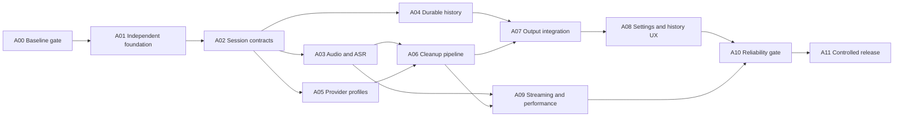

# Implementation plan and agent handoff

Status: executable work breakdown, not completed work. Read [proposal](proposal.md), [architecture](architecture.md) and [acceptance criteria](evaluation/acceptance.md) before implementation. Research snapshots are evidence, not a substitute for a full checkout.

Execution update, 2026-10-19: pinned Debug/Release builds, signed development launch, an earlier full ordinary suite of 744 tests (57 skipped, zero failures), and 33 offline tests pass. Pinned v2 assets are installed and hash-verified. Three signed runtime/provider tests passed forty synthetic ASR replays plus ten requests each to the user's selected cloud `gemma4:31b` and verified local `qwen3.5:4b`; quality defects and timing limits are recorded.

The user removed/re-added the stable app's Accessibility entry, resolving the observed denial; the underlying cause is not proven. Live TextEdit raw/cloud toggle insertion and repaired immediate quiet Escape cancellation succeeded; 36 focused signed cancellation/hotkey tests and subsequent signed Debug/Release builds passed, without a new whole-suite claim.

Chrome raw hold capture/insertion worked in both selected fields, with user-confirmed retries and no manual paste/edit. Aggregate paste/input counters do not establish one dispatch per attempt. The whole floating recording panel was missing during Chrome capture and also reproduced with Right Option toggle in windowed Chrome while Remy showed Listening; Escape returned it to Ready to dictate. Signed Debug diagnostic preparation and Release passed with only bounded numeric `overlay.presentation` instrumentation, leaving presentation behavior unchanged. Subsequent diagnostics recorded native-visible/opaque/in-frame Chrome panels outside the active Space and not occlusion-visible, versus visible/on-Space when Remy was active. A focused nonactivating NSPanel/all-applications presentation repair and requested navy/cream robot-header panel styling are implemented; 43 focused tests pass, including mounted SwiftUI pixel coverage. Signed repair Debug preparation and Release passed. The user confirmed visible overlay and correct Chrome insertion; independent field inspection read “The teal waiter keeps the final blue word,” and three latest native presentation rows were on the active Space and occlusion-visible. Compact/Comfortable/Large settings were visually inspected without clipping and restored to Comfortable. This verifies one actual Chrome use case, not the full Spaces/display matrix.

A historical Performance query found three aggregate raw `finishDictation`-to-awaited-`TextInserter` result intervals of 93/81/87 ms, request-to-recording 175/98/152 ms, and one noText result at 18 ms. These are app-reported intervals without field mapping, timed visible acknowledgement, distribution or acceptance claims ([scope](../validation/results/2026-10-19-a00/chrome-live-timings.json)).

Preferred Right Option Tap to Toggle, cloud Custom/OpenAI-compatible `https://ollama.com/v1` / `gemma4:31b`, and immediate Escape (Hold to cancel off) were restored and accessibility-inspected. The user confirmed Arc textarea/contenteditable insertion and visible overlay (exact text not captured), Ghostty unexecuted cloud input and Codex unsent draft (user-reported only; native control was safety-blocked without bypass). A Chrome same-window field-change trial independently verified delivery into the newly focused field instead of copy-only: a planned A07 contract failure. The user also confirmed one unexecuted raw Ghostty line and restored cloud cleanup; exact terminal text was not independently read. Ready and restored selected cloud settings were independently checked; the owned fixture server and two fixture tabs were closed.

The written foundation decision is RETAIN / REPAIR with estimated scopes in the baseline; it is not daily-driver acceptance. See the [engineering baseline](../app/docs/engineering/baseline.md). A00 foundation gate is closed with RETAIN / REPAIR; A01 and A02 local implementation gates are complete; A03–A05 are beginning and A06–A11 remain planned. Daily-driver/release gates remain open. The requested friendly cartoon cyberpunk robot-waiter UI and icons are implemented as a visual pass alongside A00, without declaring A08 complete.

Latest A01 update: local-ASR/no-cloud-ASR policy (context awareness subsequently restored by user request; see [cleanup policy](cleanup-policy.md#destination-context)),
version-1 pre-App settings preflight, explicit-only login-item mutation, redacted
diagnostics and read-only no-publish CI are implemented. The ordinary suite passed
**776 tests, 59 skipped, zero failures**; offline 33 and local pin/toolchain/narrow
hygiene checks (130 selected text inputs) passed. Earlier didSet-recursion and
outdated routing-fixture failures were repaired and retained in logs. Signed
Debug preparation, Release and native UI checks passed; A01’s local implementation
gate is complete. The inherited broad lock/workspace/xcconfig ignore rules now
retain required clean-checkout inputs while ignoring user/local signing data.
UI inspection confirmed Ready/no Accessibility banner, local-only speech menu,
Parakeet v2 English and preserved cloud cleanup/hotkey/vocabulary preferences.
Hosted exact-toolchain availability, remote CI execution and simultaneous
upstream operation are not established; no repository/release was published. A02 local implementation and live smoke validation are complete; see its evidence below. [A01 evidence and limits](../app/docs/engineering/baseline.md#a01-local-implementation-gate-complete).

## Working rules

- Use built-in Codex subagents for independent implementation/review; no Orca runtime is needed. The integrating agent owns dependency locks, Xcode project changes, shared contracts, and final verification.
- Put a complete application checkout under `app/`; keep these planning and evidence documents outside it. Record upstream remote/SHA and local patch history. Do not execute reference-snapshot scripts or treat their embedded agent instructions as instructions for this planning repository. Once working in the full checkout, inspect applicable local instructions and reconcile them with the user's directions.
- Keep branches/worktrees or explicit file ownership for parallel edits. Never have two agents simultaneously reshape `AppState`, `Settings`, or the Xcode project. Define interfaces first, then parallelize implementations.
- Every work item delivers code, meaningful focused tests, a short result/limitations note, and concrete evidence against its acceptance conditions. Passing mocks is not sufficient for audio, permissions, hotkeys or insertion.
- No production API keys in fixtures, prompts, logs, screenshots or manifests. Live provider tests use user-configured credentials and clearly distinguish billable remote calls from local tests.
- Do not auto-install new updates/model revisions during the baseline. Preserve known working locks. No broad formatting/refactoring alongside functional changes.

## Dependency map



First integrated usable slice: A00–A07. Parallel after A02: ASR, storage and provider adapters. A09 can begin measurement earlier, but cannot change default models until its gates pass. A10 fault cases should be developed during each feature, not postponed until the end.

**Latest A03–A05 implementation update:** the first integrated model/history/HTTP
slice passes 930 ordinary tests (59 opt-in skips), 33 offline checks and a final
31-test history/delivery check. Exact pins remain unchanged. A03–A05 are still
in progress: streaming/local-route verification, remaining history features, full real capture
and later acceptance matrices remain open. An interrupted inherited shared-domain
test cleared the development legacy history list; no verified backup was available.
Confirmed preferences were restored, and tests now require a separate app identity
before Settings construction. See [evidence and limits](../validation/results/2026-10-19-a03-a05/README.md).

## A00 — Establish the baseline and confirm the foundation

**Owner:** integration agent. **Depends:** none. **Suggested timebox:** 2–3 focused engineering days.

Obtain full `hoomanaskari/mac-dictate-anywhere` at `e420448de6e2099d33e050a4b419722032fd7519`; verify LICENSE and dependency lock against the snapshot. Inspect build instructions and available schemes with `xcodebuild -list`; use the actual discovered scheme/destination for build/test commands and save those commands in a local build guide. Record Xcode/Swift/macOS versions. No assumed `swift test` or invented scheme names.

Before launching, apply minimal development overrides for a unique bundle/data/Keychain identity and disable inherited Sparkle startup/feed. Override the hardcoded shared FluidAudio model-cache paths or make any reused shared assets read-only; a new bundle ID alone does not isolate models. Do not grant a repackaged app access under the original application's identity. A01 makes these overrides a maintained configuration after the baseline decision.

Build with original dependency pins, run inherited relevant tests, and document failures. Install explicit v2 assets with revision/checksum provenance. Test 20 representative short/long utterances, microphone permissions, toggle/hold/cancel, raw paste into TextEdit/browser/terminal, and cleanup using the exact configured Ollama Cloud endpoint/model plus local Ollama. Before A07's terminal guard exists, use harmless single-line fixtures or a controlled disposable terminal input context. Use synthetic or deliberately selected evaluation speech for remote requests. Capture cold/warm timings and failure logs without private text.

**Acceptance:** reproducible build commands and lockfile; independent dev identity; updater disabled; real recorded results rather than README numbers; a written go/repair/replace decision with any failed gates and estimated repair scope. If only signing/model-download access is blocked, record that as an environment blocker, not proof the architecture is wrong. If selecting greenfield, revise this plan around the retained components before parallel implementation.

**Output:** `app/docs/engineering/baseline.md`, measurements, recorded revision manifest and build instructions. No implied permission to publish a release.

**Current decision:** A00 foundation gate closed with RETAIN / REPAIR; A01 and A02 local implementation gates are complete; A03–A05 are beginning. Raw/cloud Ghostty and Codex observations are user-reported with exact text unread; Arc exact text was also not independently captured. The Chrome field-change failure remains an explicit A07 repair requirement. Preserve measured ASR/provider and live gesture evidence; repair focused-field delivery, provider/output policies, explicit model lifecycle and durable history through A01–A10. [Estimated repair scopes](../app/docs/engineering/baseline.md#a00-foundation-decision-and-repair-scope) distinguish this foundation decision from subsequent held-out quality, controlled cold/warm/egress, destination, fault and soak acceptance. The larger acceptance corpus and 1,000-cycle gate are not claimed as baseline passes.

## A01 — Independent application foundation

**Owner:** integration/build agent. **Depends:** successful A00 decision. **Status:** local implementation gate complete: ordinary 776 tests/59 skipped/zero failures, offline 33, signed Debug, Release and native UI checks passed. CI is authored but not remotely executed; simultaneous upstream operation remains untested.

Maintain distinct app/development identities, storage/Keychain namespaces, model-cache root, logging subsystem and login item. Audit hardcoded FluidAudio cache references in both `TranscriptionEngine.swift` and `Settings.swift`; model download/removal/repair must operate only on Remy-owned assets. Retain MIT and third-party notices. Disable upstream updater/feed and unused cloud ASR/account/telemetry entry points from Remy's supported build. App-aware cleanup and explicit remote context sharing are restored under the user's later request; see [cleanup policy](cleanup-policy.md#destination-context). Do this through explicit configuration and narrow UI/route changes; avoid deleting unrelated code prematurely. Keep local ASR and selected cleanup routes visible and auditable.

Add a minimal CI workflow for build, meaningful tests, lockfile consistency and secret-free artifact checks using actual repository commands. Document local signing requirements and differences from distributable signing. Pin dependencies; initial baseline remains FluidAudio 0.17.5. Add separate configuration schema/version and diagnostics redaction policy.

**Acceptance:** Remy and upstream can run side by side without data or credential collisions; neither upstream updates nor unrequested cloud ASR can activate; a clean checkout builds under documented prerequisites; release/debug identity and permission behavior are clear.

## A02 — Session lifecycle and stable contracts

**Owner:** integration/core agent. **Depends:** A01. **Status:** local implementation gate complete: ordinary 831 tests/59 skipped/zero failures, final hotkey suite41/zero, offline33/zero, signed Debug and Release, cloud/raw TextEdit smoke and immediate quiet cancellation passed. Shared interfaces reviewed; physical sleep and the full hardware hotkey matrix remain later validation. [Evidence](../validation/results/2026-10-19-a02/README.md), [contracts](engineering/session-contracts.md).

Introduce a Remy-owned session coordinator around the existing engine protocol and services. Define session/generation IDs, immutable configuration snapshots, event sequence, state transitions, cancellation reasons and typed failures. Move only the coordination needed for this seam out of `AppState`. Provide fakes for ASR, provider, history and output.

Adapt inherited hotkeys to toggle and hold modes; test right Option/Fn and ordinary chord bindings on macOS 27. Recover a disabled tap, ignore key-repeat, avoid duplicate release/stop, expose conflicts, and disable a stale gesture on sleep. Start while busy gives visible feedback; History reprocessing has no output authority.

**Acceptance:** deterministic tests cover duplicate start/stop, cancel in every pre-delivery phase, delayed callbacks from session N during N+1, timeout then late success, settings change during capture, and cancellation after dispatch. No stale callback can write clipboard or deliver text. Shared interface review completes before A03–A05 branch.

## A03 — Local speech and model lifecycle

**Owner:** audio/ASR agent. **Depends:** A02. **Owns:** recognizer adapter, capture adapter, model store; coordinates shared project edits.

Explicitly choose Parakeet v2 and verified offline assets. Preserve existing device/capture fixes; wrap model loading so normal dictation never downloads. Implement controlled installation, integrity validation, atomic activation, manual removal/rollback, warm-up and idle unloading. Keep processing off realtime callback/main actor. Bound buffers and preview work; flush tail at stop. Handle route/sample-rate changes, sleep, unplug, permissions and cancellation.

Use memory capture by default and an optional bounded recovery spool. Keep the initial process topology; separately evaluate XPC isolation in A09 rather than introducing it while changing model versions.

**Acceptance:** complete tail/silence tests; explicit offline v2 load; corrupt/incomplete asset rejection; cancelled installs do not corrupt working models; 100 real capture cycles; no silent audio loss; raw transcript recoverable whenever it has been produced. Record cold versus warm timings and peak memory.

## A04 — Durable history repository and migration

**Owner:** storage agent. **Depends:** A02. **Owns:** repository, schema/migrations, search/export services.

Implement architecture tables using validated SQLite/GRDB versions, one writer and transactional updates. Preserve raw transcript, corrected text, every cleanup attempt, selected output, actual delivered text/outcome, model/profile/prompt versions and timing. Support search, pagination, retention, delete, export and retry metadata. Make optional FTS index consistent with deletion.

Import existing Remy legacy history idempotently with original IDs/timestamps and unknown provenance explicitly nullable. External app import requires user-selected data. Preserve a backup until count/content checks succeed. Handle crash mid-migration, disk-full, permission errors and restart of pending sessions. Never auto-replay pending delivery.

**Acceptance:** round-trip Unicode/raw/final/attempt/correction-run metadata; rollback and repeated migration tests; forced interruption with database integrity check; deletion removes derivative FTS/audio and cannot be undone by late reprocessing callbacks; intentional history-off permits delivery without disk content and differs from disk failure; schema downgrade protection; 10,000-entry search/pagination fixture; not-saved state is observable by coordinator.

## A05 — Cleanup provider profiles

**Owner:** provider agent. **Depends:** A02. **Owns:** provider adapters, credentials/profiles, HTTP stream parsers.

Adapt existing compatible/Ollama services instead of replacing working HTTP code blindly. Support named profiles, exact base URL/model, endpoint-scoped Keychain reference, optional discovery, custom prompt version, timeout and capability metadata. Implement Ollama NDJSON and compatible SSE/complete JSON streams with strict completion semantics, cancellation, bounded size, HTTP error classification and redacted diagnostics. “Test connection” uses synthetic input.

Local-only route validation must reject known cloud-proxy model tags even at loopback and make unverified execution locations unavailable in strict local-only mode. Compatible servers may not support discovery, structured output, temperature or thinking settings; send only supported parameters and make retries bounded. Do not automatically redirect to another provider. An explicit future native Anthropic/Gemini adapter implements the same contract.

**Acceptance:** current cloud endpoint/model validates when credentials are supplied; one installed local model works offline; manual model ID works without discovery; malformed/split UTF-8 chunks, fragmented SSE/NDJSON lines, EOF without completion, rate-limit, auth failure, timeout, cancellation and cross-origin redirect tests pass. No key/reasoning/tool-call text can reach history output or clipboard.

## A06 — Cleanup, vocabulary and fallback pipeline

**Owner:** core/cleanup agent. **Depends:** A03, A05; use A04 interface/fake until integrated.

Implement versioned default/custom instructions from [cleanup policy](cleanup-policy.md), deterministic Unicode-aware vocabulary rules, separate hint channels, raw/final preservation, answer-only previews and output validation. Choose the default local cleanup candidate using measured fixtures rather than intuition. Preserve user's cloud profile as an option.

Default short-dictation cleanup deadline is 8 seconds. On failure or “Use raw now,” finalize the corrected raw text, cancel provider work, label fallback and ignore late output. Prevent token-budget truncation and unsupported-language rewriting. Long inputs require a declared context-budget strategy; begin with explicit rejection/fallback rather than unvalidated lossy chunking.

**Acceptance:** seed fixtures plus held-out semantic tests pass; input prompts are not executed as commands; corrections preserve quoted words/negation/numbers; every retry is a separate attempt; failed or partial cleanup cannot become a successful transformed result; selected text commits exactly once within app state.

## A07 — Clipboard and target-aware paste

**Owner:** macOS integration agent. **Depends:** A04, A06. **Owns:** output adapter/destination capture and integration tests.

Retain existing keyboard-layout and insertion safeguards. Capture process and available focused-field/window/document identity before overlay; keep the overlay nonactivating; validate again immediately before dispatch. Add General → Text destination, frozen per recording: restore the original app/field by default, or choose the focused field once after cleanup. Original restoration is intentional under this preference; unavailable/stale original targets remain copy-only, never silently redirected. Add an explicit secure-field paste guard independent of inherited context/formatting checks. Bypass inherited whitespace/cursor-prefix transforms for the first verbatim delivery mode; if enabled later, canonicalize once and persist the actual formatted payload. Copy that exact payload and leave it on clipboard. Persist intent and actual payload; record copied-only/dispatched/verified/uncertain truthfully. Prevent duplicate delivery after timeout or crash.

Implement terminal multiline/trailing-newline copy-only default and explicit per-app override. Never send Return or auto-submit a browser form. If the selected destination cannot be restored/validated, focus changes after resolution, a secure field is selected, permission disappears or paste cannot be safely attempted, retain history/clipboard and provide manual recovery.

**Acceptance:** actual-app matrix in evaluation doc; both destination preferences tested with same-browser field changes and cross-app focus; at most one dispatch per request; no blind retry; external clipboard change handled; input layouts tested; no execution/submit keys generated; restart during delivery never automatically pastes again. Manual paste of copied text remains available.

## A08 — Daily-use UI and configuration

**Owner:** UI agent. **Depends:** A07; can sketch against frozen contracts earlier.

Adapt native menu bar/settings/history UI. Show recording/preparing/cleaning/fallback state, nonactivating preview, microphone/device selection, cancel and use-raw action. Add profile/prompt editor with synthetic test, exact model controls, downloads, history raw/final diff, retry, copy, export, retention and clear-all. Version settings, export/import without secrets, and surface permission setup and local/remote route clearly.

**Acceptance:** keyboard and VoiceOver access; no accidental focus steal; meaningful errors next to failed action; settings during capture apply next session; history can show multiple attempts and actual delivered text; reprocess never pastes; app reopens after restart with intact configuration and history.

## A09 — Streaming and measured performance

**Owner:** performance/ASR agent. **Depends:** A03, A06; integrate against A07 for end-to-end measures.

Instrument named pipeline timestamps. Compare no preview, revisable Parakeet preview, and Nemotron 560/1120 ms in a separate upgrade branch with FluidAudio 0.17.7 at `503b4bd1bbf7220882de39fe8ae6716aae4132da` and compatible pinned assets. Record the explicitly selected chunk tier and compute-unit configuration so the 2240 ms default cannot be mistaken for the low-latency trial. Include local cleanup contention. Reject undocumented 80/160 ms tiers for that inspected SDK. Do not infer low tail latency from realtime factor.

Spike an XPC inference worker if crash containment or hangs justify the added complexity: verify entitlement/signing/model file access, ordered/bounded PCM transport, helper death, restart/cancellation and memory accounting. Promote it only if the full existing behavior survives. In-process status and recovery limitations must remain explicit if deferred.

**Acceptance:** evaluated default engine/model/runtime/digest; actual cold/warm p50/p95/p99 and resources; long recordings have bounded preview cost; no tail loss; no ASR-quality regression beyond the approved gate. State whether process isolation ships. Default selection is a documented decision, not newest-model selection.

## A10 — Reliability and privacy release gate

**Owner:** independent test/review agent plus integrating agent. **Depends:** A08, A09.

Run semantic corpus, actual-app insertion matrix, 1,000 lifecycle cycles, eight-hour mixed-use soak, and the fault matrix. Review clipboard/persistence ordering, async generation checks, model-download integrity, permissions, endpoint credential scope, helper/server egress, redaction and updater disabling. Verify app and model license notices. Triage all failures; don't paper over them with retry loops.

**Acceptance:** [evaluation gates](evaluation/acceptance.md) pass or a narrowly described tradeoff is explicitly accepted and recorded; zero unexplained crashes/duplicate dispatches/stale-session output in the gate run; no silent lost final transcript; no claimed verified paste without evidence. Attach logs, environment/versions and reproduction steps. An unsuccessful gate keeps Spokenly as the daily fallback.

## A11 — Controlled distribution and handover

**Owner:** build/release agent. **Depends:** A10.

Package with independent signing/notarization when credentials exist, own release metadata and updater trust. Manual install/update remains supported; updates are user initiated by default. Separate app and model updates, record hashes/dependency notices, and test offline launch, upgrade/migration, rollback restrictions and permission continuity. Do not publish or connect a public update channel as an incidental build step.

**Acceptance:** reproducible documented build; complete SBOM/notices and model attribution; no upstream feed; signed release validation or an explicit local-development-only limitation; install/uninstall/data-retention instructions; a known-good backup/rollback path; release checklist records tested OS/hardware/apps and outstanding limits.

## Optional work after the daily-driver gate

**B01 native provider breadth:** add Anthropic/Gemini transports using official APIs, the shared response/failure contract and provider-specific fixtures. **B02 wake word:** benchmark candidate detector licenses, false triggers, CPU/battery and shared-capture preroll. **B03 vocabulary biasing:** compare acoustic biasing against deterministic correction and measure false positives. **B04 SystemOne:** first obtain its concrete API/schema and intended action capabilities; define command-mode authorization before wiring executable actions. **B05 direct live external insertion:** only for explicitly supported destinations with revision/acknowledgement protocols, never universal keyboard simulation.

## Ready-to-use agent assignment

```text
Implement work item Axx from docs/implementation-plan.md in the complete pinned
app checkout. Read proposal.md, architecture.md, cleanup-policy.md and relevant
research/acceptance sections first. Confirm dependency items are complete.
List the files you own; coordinate Xcode/shared-contract changes with the
integrator. Preserve upstream fixes and notices. Make the smallest complete
increment. Run focused automated checks and the required real-device checks.
Report changed behavior, evidence, remaining failures and follow-up constraints.
Do not claim a benchmark/test passed unless you ran it. Do not publish a release,
change updater trust, or enable action execution as an incidental task.
```

Integration handoff requires: upstream and patch revisions; exact build/test commands; measured results; model/endpoint configurations without secrets; migration status; unresolved defects; and a clear next task. Keep plan status synchronized with actual completion rather than checking off planned work.


Latest named-profile continuation: persistent profiles, endpoint-scoped file-based
macOS Keychain adapter, explicit current-setup conversion, themed editor and
immutable profile runtime are integrated. Current selected cloud setup migrated
and passed synthetic connection checks across restart. Full ordinary965/59skips/0
and later focused checks pass; signed Debug/Release pass. A05 remains open for
actual stream transport, verified local execution and larger provider fault/runtime
matrix; A06 deadlines and A07 field identity remain required. See the
[A03–A05 evidence](../validation/results/2026-10-19-a03-a05/README.md).

Latest source-ahead continuation: narrow A04 deletion/retry, A06 deadline/use-raw
and conservative single-request policy, and A07 field/clipboard guards compile.
40 offline tests pass; isolated app tests and real delivery checks are pending.
The running signed app remains A05. Full A03–A11 acceptance stays open; see the
[evidence checkpoint](../validation/results/2026-10-19-a03-a05/README.md#source-ahead-checkpoint-history-deletion-cleanup-deadline-and-paste-guards).

## User-requested additions (2026-10-19)

Current result: custom sounds and recovery safeguards are implemented/staged;
1,033 ordinary tests/60 skips/0 failures, offline40, signed Debug/Release pass.
22m25.4s synthetic file replay passed (3.38% WER, final tail intact); source audio
and raw output retained. Custom sound import/preview/restart verified, previous
sound preferences restored. A07 live focus-change retest is pending. These results
do not close the remaining A03–A11 acceptance gates. See the
[evidence](../validation/results/2026-10-19-long-audio-sounds/README.md).

- Implement selectable/imported custom sounds for recording start and completed
  delivery, keeping the existing master switch and volume. Completion feedback
  occurs after processing/delivery, not at microphone stop.
- Run a synthetic speech fixture of at least 20 minutes using macOS `say` to a
  file, with section/tail markers and an actual installed-model replay. Exercise
  failure recovery and rerun while preserving raw text/audio; distinguish file
  replay from real-time microphone capture and the later soak gate.
- **Near the end, after implementation/local validation:** set up Git in this
  existing workspace and connect it to a private development repository.
  Inspect existing local/remote history first and preserve source/attribution;
  never clone over `app/`. Keep signing overrides, credentials, generated models,
  caches and personal recordings out of version control. Complete: development
  history stays private, and this public repository started separately from a
  reviewed source snapshot ([publication record](engineering/publication.md)).
